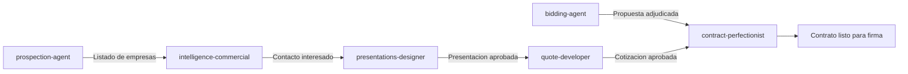

# FullService - Agentes

Monorepo de **agentes de IA** para el flujo comercial de **Campuslands — Full Service**. Cada agente automatiza una etapa del pipeline de ventas: desde la prospección y la presentación comercial al cliente, pasando por la cotización técnica y las licitaciones, hasta la redacción del contrato final.

El repositorio tiene tres zonas:

| Carpeta | Qué contiene |
|---|---|
| [`agents/`](agents/) | Los siete agentes, agrupados por la plataforma donde corren: `claude-agents/` (Claude Code, con `CLAUDE.md`) y `perplexity-agents/` (Perplexity, con `Perplexity.md`). |
| [`resources/`](resources/) | Recursos **compartidos** por todos los agentes: la marca de Campuslands y los logos de las empresas cliente. Ya no se copian dentro de cada agente. |
| [`guides/`](guides/) | La web de guías (usuario y desarrollador) de cada agente, en HTML y PDF. Es lo que publica Vercel. |

---

## Agentes

### Agentes de Claude Code — [`agents/claude-agents/`](agents/claude-agents/)

#### [presentations-designer](agents/claude-agents/presentations-designer/)

Agente de **presentaciones HTML/CSS** comerciales. Construye decks de venta personalizados por cliente **bajo el Brandbook de Campuslands** (fondos solo con colores de la marca, logos Campuslands y cliente del mismo tamaño, Poppins + Roboto Mono, máximo 10 láminas) y los exporta a PDF. Incluye verificación automática (`herramientas/`).

- **Stack:** HTML/CSS puro, estático, autocontenido.
- **Entregable:** PDF exportado desde el HTML (Chrome headless).
- **Estructura interna:**
  - `presentaciones/` — Cada presentación en su subcarpeta autocontenida *(repositorio independiente, ver [Instalación](#instalación))*.
  - `herramientas/` — `verificar_deck.py` (mide logos, fondos, fuentes, geometría, contraste, nº de láminas, PDF) y `elegir_logo.py` (logo por contraste).
  - `recursos/` — Logos oficiales recortados y vectoriales, fuentes y assets de referencia (solo lectura).
  - `wiki/` — Marca (normativa), sistema de diseño v3, verificación, flujo, bitácora; `wiki/archivo/` guarda el sistema v2.
  - `videos/`, `ai-academy/` — Material audiovisual y de formación.

#### [functional-scope](agents/claude-agents/functional-scope/)

Agente de **alcances funcionales**. Actúa como Product Manager senior y analista de negocio: lee las fuentes de un proyecto (propuestas, actas, cotizaciones, notas), detecta contradicciones y vacíos, entrevista al usuario por bloques priorizados y redacta el documento de alcance funcional para el cliente, sin inventar compromisos (estados CONFIRMADO / PROPUESTO / PENDIENTE). Se rige por el *Manual maestro para el agente generador de alcances funcionales* (`recursos/`).

- **Entregable:** documento de alcance funcional editable + resumen ejecutivo de cambios + registro de pendientes.
- **Estructura interna:**
  - `alcances/` — Carpeta por cliente con `fuentes/`, `trabajo/` y `entrega/`.
  - `plantillas/` — Ficha funcional, matriz de trazabilidad, matriz de riesgos y pendientes, y matrices de trabajo.
  - `recursos/` — Manual, plantilla Word y firmas escaneadas (solo lectura).
  - `scripts/` — Constructor del `.docx`.
  - `wiki/` — Índice de proyectos, bitácora y resumen operativo del manual.

#### [quote-developer](agents/claude-agents/quote-developer/)

Agente **desarrollador de cotizaciones**. A partir de los alcances de un proyecto, genera un PDF de cotización de alcance (desglose por módulos) y rellena el XLSX estipulado por el equipo de Campus con las estimaciones de esfuerzo por especialidad. *(Antes `quote-developer-v2`; ya no existe una versión 1 aparte.)*

- **Entregables:** PDF de alcance + XLSX de cotización.
- **Estructura interna:**
  - `cotizaciones/` — Carpeta por cliente con PDF y XLSX generados.
  - `recursos/` — Plantilla maestra XLSX (solo lectura).
  - `wiki/` — Diseño del PDF, mapeo de celdas XLSX, bitácora.

#### [bidding-agent](agents/claude-agents/bidding-agent/)

Agente **licitatorio**: especialista en licitaciones, preventa técnica, arquitectura de soluciones y estimación de proyectos de software. A partir de los cuatro documentos oficiales de un proceso (RFP, aclaraciones/preguntas y respuestas, modelo de costos oficial de la empresa y modelo de costos de cotización), analiza el proceso de forma integral y construye la propuesta completa.

- **Entregables:** propuesta técnica + estimación de horas de desarrollo + consideraciones técnicas + análisis de IA con estimación de tokens y costo. Como soporte: análisis documental, matriz de cumplimiento y los dos modelos de costos llenados y conciliados.
- **Estructura interna:**
  - `licitaciones/` — Carpeta por licitación con los entregables generados.
  - `recursos/` — Los cuatro documentos oficiales por licitación (solo lectura).
  - `habilidades/` — Skills: ingesta documental, matriz de cumplimiento, estimación de horas, modelos de costos, análisis de IA/tokens.
  - `wiki/` — Método de estimación, checklist de consideraciones técnicas, costeo de tokens, bitácora.

#### [contract-perfectionist](agents/claude-agents/contract-perfectionist/)

Agente de **redacción de contratos**. Toma los alcances, la cotización y un contrato madre (plantilla estructural con cláusulas estándar de la empresa) para generar el contrato final listo para firma.

- **Entregable:** `.docx` de contrato con membrete corporativo.
- **Estructura interna:**
  - `contratos/` — Contrato final por cliente.
  - `recursos/` — Alcances, cotizaciones, contrato madre y plantilla base (solo lectura).
  - `scripts/` — `build_contract.py` (ensambla y verifica el `.docx`).
  - `wiki/` — Glosario de cláusulas, fichas por cliente, bitácora.

### Agentes de Perplexity — [`agents/perplexity-agents/`](agents/perplexity-agents/)

Usan `Perplexity.md` en vez de `CLAUDE.md`: el mismo rol de archivo de configuración co-evolucionado con el usuario, pensado para ejecutarse como agente/Space en Perplexity.

#### [prospection-agent](agents/perplexity-agents/prospection-agent/)

Agente de **prospección de empresas** ("Radar de Campus"). Al iniciar cada conversación pide un formulario fijo de 6 datos (sector, ubicación, tamaño, número de empleados, facturación anual, cantidad de empresas) y busca en la web abierta —nunca LinkedIn— empresas que califican como prospectos, entregando un listado enriquecido con datos públicos verificables. Es el primer eslabón del pipeline de prospección; su salida alimenta a `intelligence-commercial`.

- **Stack:** Agente Perplexity, búsqueda en web abierta.
- **Entregable:** Listado de empresas en tabla + CSV (`01-empresas-encontradas.csv`).
- **Estructura interna:**
  - `prospeccion/` — Lotes de búsqueda por criterio.
  - `habilidades/` — Skills: formulario de intake, búsqueda web de empresas, enriquecimiento de datos, generación de listado de resultados.
  - `wiki/` — Perfil de usuario / ICP, enlaces útiles de búsqueda, bitácora.

#### [intelligence-commercial](agents/perplexity-agents/intelligence-commercial/)

Agente de **inteligencia comercial B2B y prospección en LinkedIn** ("Explorador de Campus"). Recibe el listado de empresas de `prospection-agent`, identifica contactos clave dentro de cada una (CTO, VP de Ingeniería, reclutadores técnicos, líderes de IA), detecta el idioma real del perfil objetivo y redacta y envía —de forma autónoma— solicitudes de conexión personalizadas en LinkedIn.

- **Stack:** Agente Perplexity, control de navegador para LinkedIn.
- **Entregable:** `04-informe-divulgacion.csv` con contactos clasificados y mensajes enviados.
- **Estructura interna:**
  - `prospeccion/` — Lotes con CSVs de empresas enriquecidas, contactos clasificados y mensajes.
  - `habilidades/` — Skills: detección de idioma, control de navegador LinkedIn, generación de mensajes personalizados, generación de tabla de registro.
  - `wiki/` — Perfil de usuario, marca Campuslands, buyer personas objetivo, bitácora.

---

## Recursos compartidos — [`resources/`](resources/)

Lo que antes se copiaba dentro del `recursos/` de cada agente vive ahora una sola vez:

```
resources/
├── campuslands-resources/        # Marca y datos de la empresa (solo lectura)
│   ├── Logo Campuslands Horizontal Azul.png · Horizontal Blanco.png
│   ├── Logo Campuslands Vertical Azul.png · Vertical Blanco.png
│   ├── isotipo-campuslands.png · favicon-campuslands.png
│   ├── Brief Fullservice.pdf
│   └── Campuslands_Brandbook2023V2._compressed (1).pdf
└── companies-logos/              # Logos de las empresas cliente, una carpeta por empresa
    ├── alcaldia-de-giron/ · avicampo/ · chico-soluciones-logisticas/ · colbeef/
    ├── compumax/ · fcv/ · financiera-comultrasan/ · gaspais/ · green-metal/
    └── marval/ · mchaileh/ · miami-aqua-tours/ · multinal/ · palmera-junior/ · unidrogas/
```

Desde la carpeta de un agente se llega con `../../../resources/` (los agentes están a tres niveles de la raíz: `agents/<grupo>/<agente>/`). Un logo nuevo de cliente se guarda en `resources/companies-logos/<empresa-slug>/`; no se copia en el agente. Los `recursos/` de cada agente conservan solo lo propio de ese agente (plantillas, manuales, documentos de entrada, fuentes tipográficas, firmas).

> Las presentaciones desplegadas (`presentaciones/`) y los videos mantienen su propia copia de los logos y fuentes que necesitan, porque cada una se despliega por separado y debe ser autocontenida.

---

## Guías — [`guides/`](guides/)

Web con dos guías por agente (usuario y desarrollador), en HTML y PDF. `vercel.json` publica solo esta carpeta. Cómo editarlas, generarlas y verlas en local: [`guides/README.md`](guides/README.md).

---

## Estructura del repositorio

```
fullservice-agents/
├── readme.md
├── vercel.json                       # publica solo guides/
├── .claude/launch.json               # servidor local de las guías
├── agents/
│   ├── claude-agents/
│   │   ├── presentations-designer/   # CLAUDE.md · presentaciones/ · herramientas/ · recursos/ · wiki/ · videos/
│   │   ├── functional-scope/         # CLAUDE.md · alcances/ · plantillas/ · recursos/ · scripts/ · wiki/
│   │   ├── quote-developer/          # CLAUDE.md · cotizaciones/ · recursos/ · wiki/
│   │   ├── bidding-agent/            # CLAUDE.md · licitaciones/ · habilidades/ · recursos/ · wiki/
│   │   └── contract-perfectionist/   # CLAUDE.md · contratos/ · recursos/ · scripts/ · wiki/
│   └── perplexity-agents/
│       ├── prospection-agent/        # Perplexity.md · prospeccion/ · habilidades/ · wiki/
│       └── intelligence-commercial/  # Perplexity.md · prospeccion/ · habilidades/ · wiki/
├── resources/
│   ├── campuslands-resources/
│   └── companies-logos/
└── guides/                           # index.html · <agente>/guia-*.html|pdf · assets/ · _src/
```

---

## Instalación

### 1. Clonar el repositorio principal

```bash
git clone https://github.com/GustavoAdolfoNavarroPacheco/fullservice-agents
cd fullservice-agents
```

### 2. Clonar el repositorio de Presentaciones

La carpeta `agents/claude-agents/presentations-designer/presentaciones/` vive en un **repositorio independiente** (no es un submódulo de Git). Debe clonarse por separado después de la clonación principal:

```bash
cd agents/claude-agents/presentations-designer
git clone https://github.com/GustavoAdolfoNavarroPacheco/Presentaciones presentaciones
cd ../../..
```

> [!IMPORTANT]
> `presentaciones/` es un repositorio Git aparte con su propio historial y remote (`GustavoAdolfoNavarroPacheco/Presentaciones`). Los commits y pushes de las presentaciones se hacen **dentro** de esa carpeta, independientemente del repositorio padre.

### Verificación

Después de ambas clonaciones, la estructura debería verse así:

```
fullservice-agents/                                       ← remote: fullservice-agents
└── agents/claude-agents/presentations-designer/
    └── presentaciones/                                   ← remote: Presentaciones
```

Puedes verificar que ambos repositorios están correctamente configurados con:

```bash
# Desde la raíz del proyecto
git remote -v
# origin  https://github.com/GustavoAdolfoNavarroPacheco/fullservice-agents (fetch/push)

# Desde agents/claude-agents/presentations-designer/presentaciones/
cd agents/claude-agents/presentations-designer/presentaciones
git remote -v
# origin  https://github.com/GustavoAdolfoNavarroPacheco/Presentaciones (fetch/push)
```

---

## Convenciones generales

| Convención | Detalle |
|---|---|
| **Idioma** | Todo en español. |
| **Slug de cliente** | Minúsculas, sin espacios ni tildes, separado por guiones (ej. `casa-blanca`). |
| **`recursos/` de cada agente** | Solo lectura — fuentes propias de ese agente, provistas por el usuario. |
| **`resources/` (raíz)** | Recursos compartidos por todos los agentes (marca de Campuslands y logos de clientes). Se referencian desde el agente como `../../../resources/…`; no se duplican. |
| **`wiki/`** | Conocimiento acumulado por el agente: bitácora (`log.md`), catálogo (`index.md`), guías de diseño. |
| **Salidas por cliente/lote** | Cada cliente o lote tiene su subcarpeta autocontenida dentro de `presentaciones/`, `cotizaciones/`, `licitaciones/`, `contratos/`, `alcances/` o `prospeccion/`. |
| **Veracidad** | Los agentes nunca inventan información. Datos faltantes se marcan como `[PENDIENTE]` (o se dejan en blanco con la fuente consultada, en los agentes de prospección) y se consultan al usuario. |
| **Agentes Perplexity** | `prospection-agent` e `intelligence-commercial` usan `Perplexity.md` en vez de `CLAUDE.md`. Si su Space necesita un archivo de `resources/`, se sube desde allí. |

---

## Flujo comercial



Hay tres vias de entrada al pipeline:

**Via de prospeccion (origen del lead)**

1. **Prospeccion de empresas** — Se buscan en la web abierta empresas que califican como prospecto segun el ICP.
2. **Inteligencia comercial** — Se identifican contactos clave dentro de esas empresas y se les escribe en LinkedIn para iniciar la conversacion comercial.

**Via comercial directa**

1. **Presentacion** — Se construye el deck comercial para el cliente.
2. **Cotizacion** — Con los alcances definidos, se genera el PDF de alcance y el XLSX de costos.
3. **Contrato** — Se redacta el contrato final a partir de los alcances, la cotizacion y el contrato madre.

**Via licitatoria**

1. **Propuesta licitatoria** — A partir de los cuatro documentos oficiales del proceso, se construyen la propuesta tecnica, la estimacion de horas, las consideraciones tecnicas y el analisis de IA/tokens, con los dos modelos de costos conciliados.
2. **Contrato** — Si el proceso se adjudica, se redacta el contrato a partir de la propuesta y el modelo de costos radicado.
