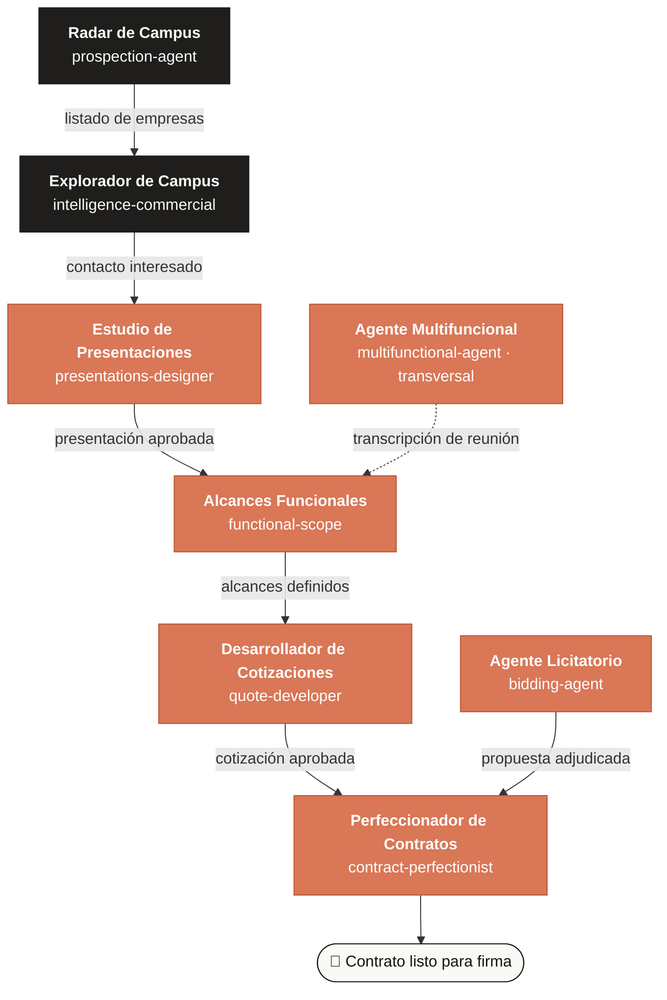
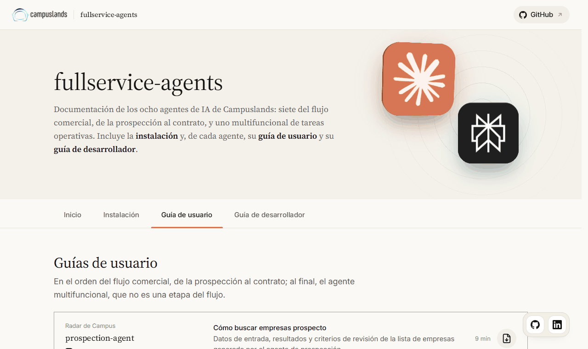
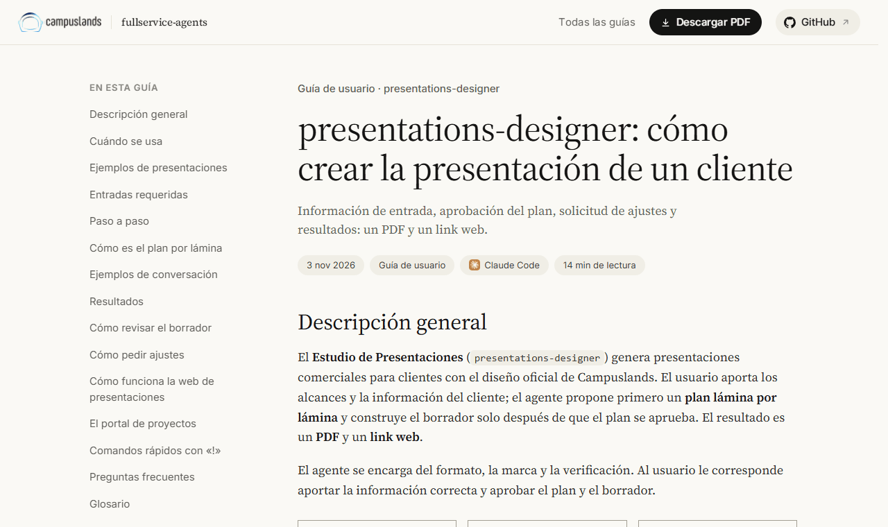

<div align="center">

<a href="https://fullservice-agents.vercel.app"><picture><source media="(prefers-color-scheme: dark)" srcset=".github/assets/banner-dark.svg"/></picture></a>

<br/>

<a href="https://fullservice-agents.vercel.app"></a>


<a href="LICENSE"></a>
<a href="https://github.com/GustavoAdolfoNavarroPacheco/fullservice-agents/actions/workflows/ci.yml"></a>
<a href="https://github.com/GustavoAdolfoNavarroPacheco/fullservice-agents/commits/main"></a>

<br/><br/>

**[Web de guías](https://fullservice-agents.vercel.app/inicio)** · **[Instalación](https://fullservice-agents.vercel.app/inicio/instalacion)** · **[Guías de usuario](https://fullservice-agents.vercel.app/inicio/usuario)** · **[Guías de desarrollador](https://fullservice-agents.vercel.app/inicio/desarrollador)**

[Agentes](#los-ocho-agentes) · [Flujo comercial](#flujo-comercial) · [Instalación](#instalación) · [Estructura](#estructura-del-repositorio) · [Seguridad y comunidad](#seguridad-licencia-y-comunidad)

</div>

---

## ¿Qué es?

Monorepo de **agentes de IA** para el flujo comercial de **Campuslands — Full Service**. Cada agente automatiza una etapa del trabajo: desde encontrar empresas y escribirles, pasando por la
presentación, el alcance y la cotización, hasta el contrato final; y uno más, multifuncional, resuelve tareas operativas del equipo. Cada agente es una carpeta con sus **instrucciones** (`CLAUDE.md` o
`Perplexity.md`), su **wiki** y lo que necesita para trabajar, y todos comparten los mismos [recursos](resources/) de marca.

| 🤖 Agentes | 🧩 Plataformas | 📚 Guías | 🌎 Idioma |
|:---:|:---:|:---:|:---:|
| **8** | **Claude Code** · **Perplexity** | **16** (usuario + desarrollador) | **Español** |

## Flujo comercial



<sub>🟠 agentes de Claude Code · ⚫ agentes de Perplexity</sub>

Hay tres vías de entrada al pipeline:

**Vía de prospección (origen del lead)**

1. **Prospección de empresas** — Se buscan en la web abierta empresas que califican como prospecto según el ICP.
2. **Inteligencia comercial** — Se identifican contactos clave dentro de esas empresas y se les escribe en LinkedIn para iniciar la conversación comercial.

**Vía comercial directa**

1. **Presentación** — Se construye el deck comercial para el cliente.
2. **Cotización** — Con los alcances definidos, se genera el PDF de alcance y el XLSX de costos.
3. **Contrato** — Se redacta el contrato final a partir de los alcances, la cotización y el contrato madre.

**Vía licitatoria**

1. **Propuesta licitatoria** — A partir de los cuatro documentos oficiales del proceso, se construyen la propuesta técnica, la estimación de horas, las consideraciones técnicas y el análisis de IA/tokens, con los dos modelos de costos conciliados.
2. **Contrato** — Si el proceso se adjudica, se redacta el contrato a partir de la propuesta y el modelo de costos radicado.

> **Fuera del flujo:** `multifunctional-agent` no es una etapa del pipeline comercial; es un agente transversal que cualquier persona del equipo usa cuando la tarea lo pide (unificar facturas, transcribir una reunión). La transcripción de una reunión con un cliente puede alimentar luego a `functional-scope` como fuente de un alcance.

## Los ocho agentes

| Agente | Nombre | Plataforma | Qué hace | Entregable | Guías |
|---|---|---|---|---|---|
| [`prospection-agent`](agents/perplexity-agents/prospection-agent/) | **Radar de Campus** | Perplexity | Encuentra empresas prospecto en la web abierta (nunca LinkedIn) | Listado + CSV | [Usuario](https://fullservice-agents.vercel.app/prospection-agent/guia-usuario) · [Desarrollador](https://fullservice-agents.vercel.app/prospection-agent/guia-dev) |
| [`intelligence-commercial`](agents/perplexity-agents/intelligence-commercial/) | **Explorador de Campus** | Perplexity | Identifica contactos clave y les escribe en LinkedIn | Informe CSV | [Usuario](https://fullservice-agents.vercel.app/intelligence-commercial/guia-usuario) · [Desarrollador](https://fullservice-agents.vercel.app/intelligence-commercial/guia-dev) |
| [`presentations-designer`](agents/claude-agents/presentations-designer/) | **Estudio de Presentaciones** | Claude Code | Decks comerciales HTML/CSS por cliente, bajo el Brandbook de Campuslands | PDF + link web | [Usuario](https://fullservice-agents.vercel.app/presentations-designer/guia-usuario) · [Desarrollador](https://fullservice-agents.vercel.app/presentations-designer/guia-dev) |
| [`functional-scope`](agents/claude-agents/functional-scope/) | **Alcances Funcionales** | Claude Code | Lee las fuentes de un proyecto y redacta su documento de alcance funcional, sin inventar compromisos | Word editable + pendientes | [Usuario](https://fullservice-agents.vercel.app/functional-scope/guia-usuario) · [Desarrollador](https://fullservice-agents.vercel.app/functional-scope/guia-dev) |
| [`quote-developer`](agents/claude-agents/quote-developer/) | **Desarrollador de Cotizaciones** | Claude Code | Convierte los alcances en una cotización por módulos | PDF + Excel | [Usuario](https://fullservice-agents.vercel.app/quote-developer/guia-usuario) · [Desarrollador](https://fullservice-agents.vercel.app/quote-developer/guia-dev) |
| [`bidding-agent`](agents/claude-agents/bidding-agent/) | **Agente Licitatorio** | Claude Code | Analiza los cuatro documentos de una licitación y construye la propuesta completa | Propuesta, horas, costos, análisis de IA | [Usuario](https://fullservice-agents.vercel.app/bidding-agent/guia-usuario) · [Desarrollador](https://fullservice-agents.vercel.app/bidding-agent/guia-dev) |
| [`contract-perfectionist`](agents/claude-agents/contract-perfectionist/) | **Perfeccionador de Contratos** | Claude Code | Redacta el contrato final a partir de alcances, cotización y contrato madre | Word con membrete | [Usuario](https://fullservice-agents.vercel.app/contract-perfectionist/guia-usuario) · [Desarrollador](https://fullservice-agents.vercel.app/contract-perfectionist/guia-dev) |
| [`multifunctional-agent`](agents/claude-agents/multifunctional-agent/) | **Agente Multifuncional** | Claude Code | Unifica facturas y transcribe audios en local; tareas operativas fuera del flujo comercial | Word + PDF | [Usuario](https://fullservice-agents.vercel.app/multifunctional-agent/guia-usuario) · [Desarrollador](https://fullservice-agents.vercel.app/multifunctional-agent/guia-dev) |

> Cada agente tiene dos guías en la web: la de **usuario** (qué darle, qué recibes, cómo revisarlo) y la de **desarrollador** (cómo está construido y cómo se mantiene), en HTML y en PDF.

<details open>
<summary><b>Detalle de cada agente</b> (haz clic en uno para abrirlo)</summary>

<br/>

#### Agentes de Claude Code — [`agents/claude-agents/`](agents/claude-agents/)

<details>
<summary><b><code>presentations-designer</code></b> — Estudio de Presentaciones <sub>· Claude Code</sub></summary>

Agente de **presentaciones HTML/CSS** comerciales. Construye decks de venta personalizados por cliente **bajo el Brandbook de Campuslands** (fondos solo con colores de la marca, logos Campuslands y cliente del mismo tamaño, Poppins + Roboto Mono, máximo 10 láminas) y los exporta a PDF. Incluye verificación automática (`herramientas/`).

- **Stack:** HTML/CSS puro, estático, autocontenido.
- **Entregable:** PDF exportado desde el HTML (Chrome headless).
- **Estructura interna:**
  - `presentaciones/` — Cada presentación en su subcarpeta autocontenida *(repositorio independiente, ver [Instalación](#instalación))*.
  - `herramientas/` — `verificar_deck.py` (mide logos, fondos, fuentes, geometría, contraste, nº de láminas, PDF) y `elegir_logo.py` (logo por contraste).
  - `recursos/` — Logos oficiales recortados y vectoriales, fuentes y assets de referencia (solo lectura).
  - `wiki/` — Marca (normativa), sistema de diseño v3, verificación, flujo, bitácora; `wiki/archivo/` guarda el sistema v2.
  - `videos/`, `ai-academy/` — Material audiovisual y de formación.

</details>
<details>
<summary><b><code>functional-scope</code></b> — Alcances Funcionales <sub>· Claude Code</sub></summary>

Agente de **alcances funcionales**. Actúa como Product Manager senior y analista de negocio: lee las fuentes de un proyecto (propuestas, actas, cotizaciones, notas), detecta contradicciones y vacíos, entrevista al usuario por bloques priorizados y redacta el documento de alcance funcional para el cliente, sin inventar compromisos (estados CONFIRMADO / PROPUESTO / PENDIENTE). Se rige por el *Manual maestro para el agente generador de alcances funcionales* (`recursos/`).

- **Entregable:** documento de alcance funcional editable + resumen ejecutivo de cambios + registro de pendientes.
- **Estructura interna:**
  - `alcances/` — Carpeta por cliente con `fuentes/`, `trabajo/` y `entrega/`.
  - `plantillas/` — Ficha funcional, matriz de trazabilidad, matriz de riesgos y pendientes, y matrices de trabajo.
  - `recursos/` — Manual, plantilla Word y firmas escaneadas (solo lectura).
  - `scripts/` — Constructor del `.docx`.
  - `wiki/` — Índice de proyectos, bitácora y resumen operativo del manual.

</details>
<details>
<summary><b><code>quote-developer</code></b> — Desarrollador de Cotizaciones <sub>· Claude Code</sub></summary>

Agente **desarrollador de cotizaciones**. A partir de los alcances de un proyecto, genera un PDF de cotización de alcance (desglose por módulos) y rellena el XLSX estipulado por el equipo de Campus con las estimaciones de esfuerzo por especialidad. *(Antes `quote-developer-v2`; ya no existe una versión 1 aparte.)*

- **Entregables:** PDF de alcance + XLSX de cotización.
- **Estructura interna:**
  - `cotizaciones/` — Carpeta por cliente con PDF y XLSX generados.
  - `recursos/` — Plantilla maestra XLSX (solo lectura).
  - `wiki/` — Diseño del PDF, mapeo de celdas XLSX, bitácora.

</details>
<details>
<summary><b><code>bidding-agent</code></b> — Agente Licitatorio <sub>· Claude Code</sub></summary>

Agente **licitatorio**: especialista en licitaciones, preventa técnica, arquitectura de soluciones y estimación de proyectos de software. A partir de los cuatro documentos oficiales de un proceso (RFP, aclaraciones/preguntas y respuestas, modelo de costos oficial de la empresa y modelo de costos de cotización), analiza el proceso de forma integral y construye la propuesta completa.

- **Entregables:** propuesta técnica + estimación de horas de desarrollo + consideraciones técnicas + análisis de IA con estimación de tokens y costo. Como soporte: análisis documental, matriz de cumplimiento y los dos modelos de costos llenados y conciliados.
- **Estructura interna:**
  - `licitaciones/` — Carpeta por licitación con los entregables generados.
  - `recursos/` — Los cuatro documentos oficiales por licitación (solo lectura).
  - `habilidades/` — Skills: ingesta documental, matriz de cumplimiento, estimación de horas, modelos de costos, análisis de IA/tokens.
  - `wiki/` — Método de estimación, checklist de consideraciones técnicas, costeo de tokens, bitácora.

</details>
<details>
<summary><b><code>contract-perfectionist</code></b> — Perfeccionador de Contratos <sub>· Claude Code</sub></summary>

Agente de **redacción de contratos**. Toma los alcances, la cotización y un contrato madre (plantilla estructural con cláusulas estándar de la empresa) para generar el contrato final listo para firma.

- **Entregable:** `.docx` de contrato con membrete corporativo.
- **Estructura interna:**
  - `contratos/` — Contrato final por cliente.
  - `recursos/` — Alcances, cotizaciones, contrato madre y plantilla base (solo lectura).
  - `scripts/` — `build_contract.py` (ensambla y verifica el `.docx`).
  - `wiki/` — Glosario de cláusulas, fichas por cliente, bitácora.

</details>
<details>
<summary><b><code>multifunctional-agent</code></b> — Agente Multifuncional <sub>· Claude Code</sub></summary>

Agente **multifuncional** (`/multifunctional-agent`): resuelve tareas operativas recurrentes de Full Service que no pertenecen a una etapa comercial concreta. Al empezar pregunta con qué **funcionalidad** se quiere proceder:

1. **Unificación de facturas** — recibe varias facturas o recibos (PDF o imagen), los ordena en **tiempo cronológico según lo que dice cada recibo** (no el nombre del archivo) y entrega **un Word y un PDF**, una factura por hoja, bajo el banner de Campuslands (el banner vive en un solo archivo para poder rediseñarlo).
2. **Transcriptor de audio** — recibe un audio, lo transcribe **en local** (faster-whisper + separación de hablantes con sherpa-onnx) y entrega **un Word y un PDF** con la estructura de «Transcripción de Audio Completo» (partes de 5 min, intervenciones con hablante y tiempo) con el diseño de Campuslands.

- **Entregables:** Word + PDF por trabajo, siempre generados del mismo `.docx`.
- **Estructura interna:**
  - `scripts/` — `facturas.py`, `factura_banner.py`, `transcribir_audio.py`, `transcripcion.py`, `comun.py` y `autoprueba.py` (prueba de punta a punta con datos sintéticos).
  - `trabajos/` — Una carpeta por lote (`facturas/`) o por reunión (`transcripciones/`) con `entrada/` y `salida/`.
  - `recursos/` — Plantilla Word de Campuslands (solo lectura) y los modelos de voz descargados (fuera de git).
  - `wiki/` — Especificación del banner, formato de la transcripción, motor de audio, índice y bitácora.
- **Requisitos:** LibreOffice y `python-docx`, `PyMuPDF`, `Pillow`. Solo para audio: `ffmpeg` y `pip install -r scripts/requisitos-audio.txt`.

</details>

#### Agentes de Perplexity — [`agents/perplexity-agents/`](agents/perplexity-agents/)

Usan `Perplexity.md` en vez de `CLAUDE.md`: el mismo rol de archivo de configuración co-evolucionado con el usuario, pensado para ejecutarse como agente/Space en Perplexity.

<details>
<summary><b><code>prospection-agent</code></b> — Radar de Campus <sub>· Perplexity</sub></summary>

Agente de **prospección de empresas** ("Radar de Campus"). Al iniciar cada conversación pide un formulario fijo de 6 datos (sector, ubicación, tamaño, número de empleados, facturación anual, cantidad de empresas) y busca en la web abierta —nunca LinkedIn— empresas que califican como prospectos, entregando un listado enriquecido con datos públicos verificables. Es el primer eslabón del pipeline de prospección; su salida alimenta a `intelligence-commercial`.

- **Stack:** Agente Perplexity, búsqueda en web abierta.
- **Entregable:** Listado de empresas en tabla + CSV (`01-empresas-encontradas.csv`).
- **Estructura interna:**
  - `prospeccion/` — Lotes de búsqueda por criterio.
  - `habilidades/` — Skills: formulario de intake, búsqueda web de empresas, enriquecimiento de datos, generación de listado de resultados.
  - `wiki/` — Perfil de usuario / ICP, enlaces útiles de búsqueda, bitácora.

</details>
<details>
<summary><b><code>intelligence-commercial</code></b> — Explorador de Campus <sub>· Perplexity</sub></summary>

Agente de **inteligencia comercial B2B y prospección en LinkedIn** ("Explorador de Campus"). Recibe el listado de empresas de `prospection-agent`, identifica contactos clave dentro de cada una (CTO, VP de Ingeniería, reclutadores técnicos, líderes de IA), detecta el idioma real del perfil objetivo y redacta y envía —de forma autónoma— solicitudes de conexión personalizadas en LinkedIn.

- **Stack:** Agente Perplexity, control de navegador para LinkedIn.
- **Entregable:** `04-informe-divulgacion.csv` con contactos clasificados y mensajes enviados.
- **Estructura interna:**
  - `prospeccion/` — Lotes con CSVs de empresas enriquecidas, contactos clasificados y mensajes.
  - `habilidades/` — Skills: detección de idioma, control de navegador LinkedIn, generación de mensajes personalizados, generación de tabla de registro.
  - `wiki/` — Perfil de usuario, marca Campuslands, buyer personas objetivo, bitácora.

</details>

</details>

## La web de guías

La carpeta [`guides/`](guides/) es una web estática (HTML, CSS y JavaScript puro; sin dependencias) con la documentación de cada agente, que Vercel publica en
**[fullservice-agents.vercel.app](https://fullservice-agents.vercel.app)**. Tiene cuatro secciones —**Inicio**, **Instalación**, **Guía de usuario** y **Guía de desarrollador**— y un PDF A4 por guía. Cómo se genera,
se edita y se prueba: [`guides/README.md`](guides/README.md).

<p align="center">
  <a href="https://fullservice-agents.vercel.app/inicio"></a>
  <a href="https://fullservice-agents.vercel.app/presentations-designer/guia-usuario"></a>
</p>

## Instalación

> La web de guías tiene una pestaña **Instalación** con esta misma instalación: «para usuario» (un mensaje que se le da a la IA) y «para desarrollador» (los comandos), además de cómo usar cada agente como Proyecto de Claude o Space de Perplexity. En local, `guides/_src/contenido/instalacion.md` es su fuente.


#### 1. Clonar el repositorio principal

```bash
git clone https://github.com/GustavoAdolfoNavarroPacheco/fullservice-agents
cd fullservice-agents
```

#### 2. Clonar el repositorio de Presentaciones

La carpeta `agents/claude-agents/presentations-designer/presentaciones/` vive en un **repositorio independiente** (no es un submódulo de Git). Debe clonarse por separado después de la clonación principal:

```bash
cd agents/claude-agents/presentations-designer
git clone https://github.com/GustavoAdolfoNavarroPacheco/Presentaciones presentaciones
cd ../../..
```

> [!IMPORTANT]
> `presentaciones/` es un repositorio **privado**: para clonarlo y hacer `git push` hace falta que Gustavo Navarro te agregue como colaborador con permiso de escritura. La carpeta llega **vacía** al clonar el repositorio principal. Tras cada push, la presentación tarda aproximadamente **2 minutos** en verse en la web (Vercel construye y publica). En Windows, activa antes `git config --global core.longpaths true` y clona en una ruta corta.

> [!IMPORTANT]
> `presentaciones/` es un repositorio Git aparte con su propio historial y remote (`GustavoAdolfoNavarroPacheco/Presentaciones`). Los commits y pushes de las presentaciones se hacen **dentro** de esa carpeta, independientemente del repositorio padre.

#### Verificación

Después de ambas clonaciones, la estructura debería verse así:

```
fullservice-agents/                                       ← remote: fullservice-agents
└── agents/claude-agents/presentations-designer/
    └── presentaciones/                                   ← remote: Presentaciones
```

Puedes verificar que ambos repositorios están correctamente configurados con:

```bash
# Desde la raíz del proyecto
git remote -v
# origin  https://github.com/GustavoAdolfoNavarroPacheco/fullservice-agents (fetch/push)

# Desde agents/claude-agents/presentations-designer/presentaciones/
cd agents/claude-agents/presentations-designer/presentaciones
git remote -v
# origin  https://github.com/GustavoAdolfoNavarroPacheco/Presentaciones (fetch/push)
```

## Estructura del repositorio

```
fullservice-agents/
├── README.md · LICENSE · SECURITY.md · CONTRIBUTING.md · CODE_OF_CONDUCT.md · SUPPORT.md · THIRD_PARTY_NOTICES.md
├── vercel.json                       # publica solo guides/ y define las cabeceras de seguridad
├── .github/                          # banner del README, plantillas de issues y PR, CODEOWNERS, Dependabot y CI
├── .claude/                          # servidor local de las guías y comando /multifunctional-agent
├── agents/
│   ├── claude-agents/
│   │   ├── presentations-designer/   # CLAUDE.md · presentaciones/ · herramientas/ · recursos/ · wiki/ · videos/
│   │   ├── functional-scope/         # CLAUDE.md · alcances/ · plantillas/ · recursos/ · scripts/ · wiki/
│   │   ├── quote-developer/          # CLAUDE.md · cotizaciones/ · recursos/ · wiki/
│   │   ├── bidding-agent/            # CLAUDE.md · licitaciones/ · habilidades/ · recursos/ · wiki/
│   │   ├── contract-perfectionist/   # CLAUDE.md · contratos/ · recursos/ · scripts/ · wiki/
│   │   └── multifunctional-agent/    # CLAUDE.md · scripts/ · trabajos/ · recursos/ · wiki/ · .claude/commands/
│   └── perplexity-agents/
│       ├── prospection-agent/        # Perplexity.md · prospeccion/ · habilidades/ · wiki/
│       └── intelligence-commercial/  # Perplexity.md · prospeccion/ · habilidades/ · wiki/
├── resources/
│   ├── campuslands-resources/        # marca y datos de la empresa
│   ├── companies-logos/              # logos de las empresas cliente
│   └── comandos/                     # comandos «!»: fuente única y catálogo
└── guides/                           # la web: inicio.html · inicio/ · <agente>/guia-*.html|pdf · assets/ · _src/ (generador)
```

<details>
<summary><b>Recursos compartidos</b> — <code>resources/</code></summary>

<br/>

Lo que antes se copiaba dentro del `recursos/` de cada agente vive ahora una sola vez:

```
resources/
├── campuslands-resources/        # Marca y datos de la empresa (solo lectura)
│   ├── Logo Campuslands Horizontal Azul.png · Horizontal Blanco.png
│   ├── Logo Campuslands Vertical Azul.png · Vertical Blanco.png
│   ├── isotipo-campuslands.png · favicon-campuslands.png
│   ├── Brief Fullservice.pdf
│   └── Campuslands_Brandbook2023V2._compressed (1).pdf
├── companies-logos/              # Logos de las empresas cliente, una carpeta por empresa
│   ├── alcaldia-de-giron/ · avicampo/ · chico-soluciones-logisticas/ · colbeef/
│   ├── compumax/ · fcv/ · financiera-comultrasan/ · gaspais/ · green-metal/
│   └── marval/ · mchaileh/ · miami-aqua-tours/ · multinal/ · palmera-junior/ · unidrogas/
└── comandos/                     # Comandos «!» de los agentes: catálogo único y generador
    ├── comandos.py               # fuente única (comandos, a quién aplican, regla común)
    └── catalogo.md               # catálogo legible, matriz por agente y decisiones (generado)
```

Desde la carpeta de un agente se llega con `../../../resources/` (los agentes están a tres niveles de la raíz: `agents/<grupo>/<agente>/`). Un logo nuevo de cliente se guarda en `resources/companies-logos/<empresa-slug>/`; no se copia en el agente. Los `recursos/` de cada agente conservan solo lo propio de ese agente (plantillas, manuales, documentos de entrada, fuentes tipográficas, firmas).

> Las presentaciones desplegadas (`presentaciones/`) y los videos mantienen su propia copia de los logos y fuentes que necesitan, porque cada una se despliega por separado y debe ser autocontenida.

</details>

<details>
<summary><b>Comandos «!» de los agentes</b></summary>

<br/>

Los ocho agentes entienden **comandos**: órdenes cortas que el usuario escribe con un `!` delante (`!optimize`, `!notime`, `!plan`, `!audit`, `!final-delivery`…). Al reconocer uno, el agente **debe cumplirlo**; lo único que lo limita son sus reglas duras (veracidad, marca, confidencialidad y las puertas de aprobación y verificación). Se pueden combinar (`!plan !no-assumptions`), rigen la tarea en curso y `!help` lista los de cada agente.

- **Dónde está la regla:** sección «Comandos (`!`)» del `CLAUDE.md` o `Perplexity.md` de cada agente, entre las marcas `<!-- comandos:inicio -->` y `<!-- comandos:fin -->`.
- **Fuente única:** [`resources/comandos/comandos.py`](resources/comandos/comandos.py). De ahí salen esas secciones, el [catálogo](resources/comandos/catalogo.md), las tablas de las guías y una entrada en la bitácora de cada agente. No se edita a mano lo generado: se cambia el script y se corre `python -X utf8 resources/comandos/comandos.py` (con `--verificar` comprueba que nada esté desfasado).
- **No todos los comandos aplican a todos los agentes:** los de software y de UX/UI solo existen en `presentations-designer`; los de segunda opinión y multiagente usan subagentes, así que solo existen en los agentes de Claude Code (no en los de Perplexity).

</details>

<details>
<summary><b>Convenciones generales</b></summary>

<br/>

| Convención | Detalle |
|---|---|
| **Idioma** | Todo en español. |
| **Slug de cliente** | Minúsculas, sin espacios ni tildes, separado por guiones (ej. `casa-blanca`). |
| **`recursos/` de cada agente** | Solo lectura — fuentes propias de ese agente, provistas por el usuario. |
| **`resources/` (raíz)** | Recursos compartidos por todos los agentes (marca de Campuslands y logos de clientes). Se referencian desde el agente como `../../../resources/…`; no se duplican. |
| **`wiki/`** | Conocimiento acumulado por el agente: bitácora (`log.md`), catálogo (`index.md`), guías de diseño. |
| **Salidas por cliente/lote** | Cada cliente o lote tiene su subcarpeta autocontenida dentro de `presentaciones/`, `cotizaciones/`, `licitaciones/`, `contratos/`, `alcances/` o `prospeccion/`. |
| **Veracidad** | Los agentes nunca inventan información. Datos faltantes se marcan como `[PENDIENTE]` (o se dejan en blanco con la fuente consultada, en los agentes de prospección) y se consultan al usuario. |
| **Agentes Perplexity** | `prospection-agent` e `intelligence-commercial` usan `Perplexity.md` en vez de `CLAUDE.md`. Si su Space necesita un archivo de `resources/`, se sube desde allí. |

</details>

## Seguridad, licencia y comunidad

| | |
|---|---|
| 🔒 **[Seguridad](SECURITY.md)** | Cómo reportar una vulnerabilidad de forma privada y qué no debe subirse nunca al repositorio. |
| 📄 **[Licencia](LICENSE)** | Repositorio público de **consulta**, sin licencia de código abierto: todos los derechos reservados por Gustavo Adolfo Navarro Pacheco. |
| 🧾 **[Avisos de terceros](THIRD_PARTY_NOTICES.md)** | Licencias de las bibliotecas, iconos y tipografías incluidas. |
| 🤝 **[Contribuir](CONTRIBUTING.md)** | Flujo de trabajo, convenciones de commits y cómo verificar un cambio. |
| 🧭 **[Código de conducta](CODE_OF_CONDUCT.md)** | Cómo esperamos que sea la convivencia en el proyecto. |
| 💬 **[Soporte](SUPPORT.md)** | Dónde pedir ayuda, reportar un error o proponer una mejora. |

---

<div align="center">

<sub>© 2026 **[Gustavo Adolfo Navarro Pacheco](https://github.com/GustavoAdolfoNavarroPacheco)** · Todos los derechos reservados · Hecho para el flujo comercial de Campuslands — Full Service<br/>
El banner se genera con <code>guides/_src/readme_banner.py</code> a partir de la portada de la web.</sub>

</div>
